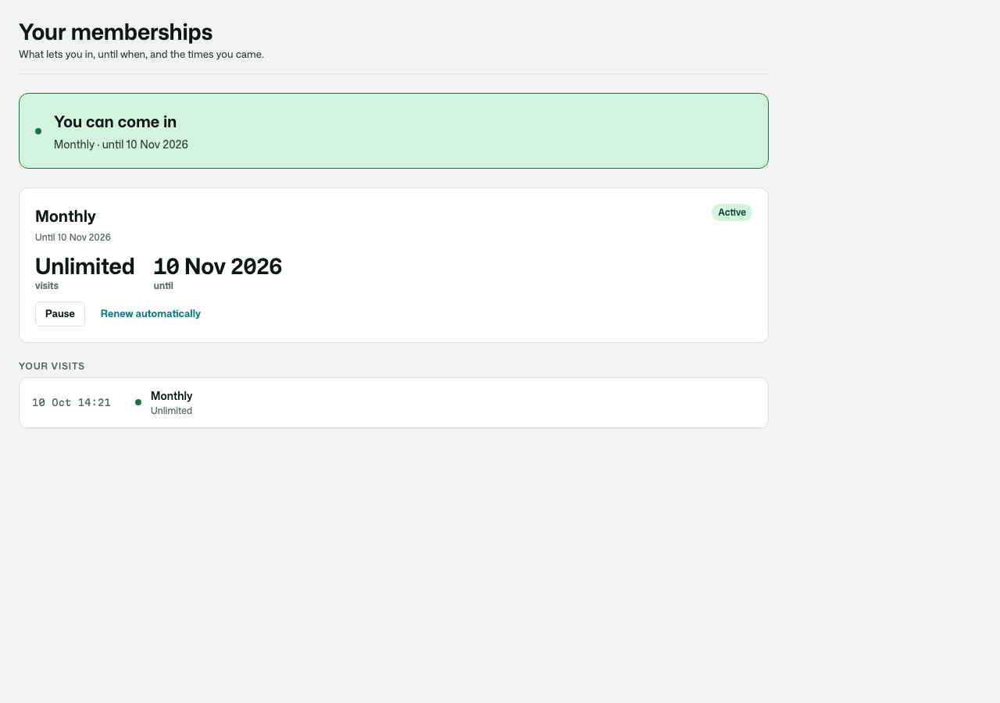
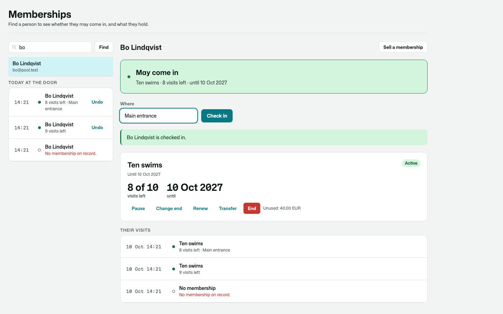
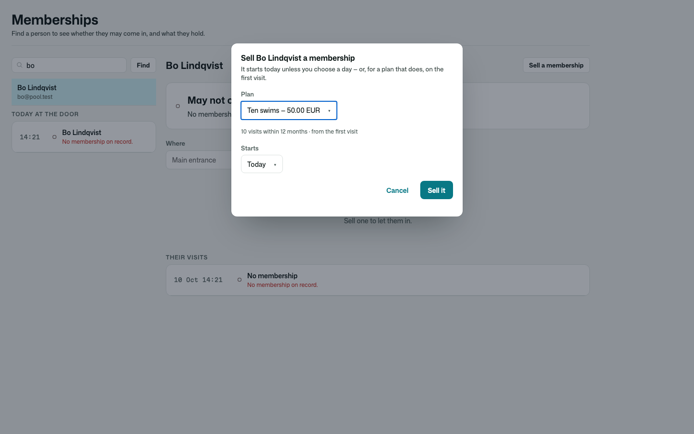
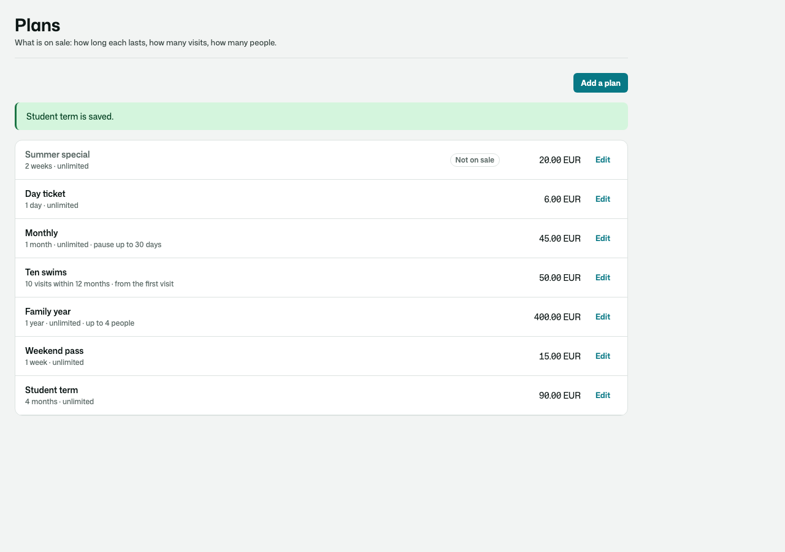
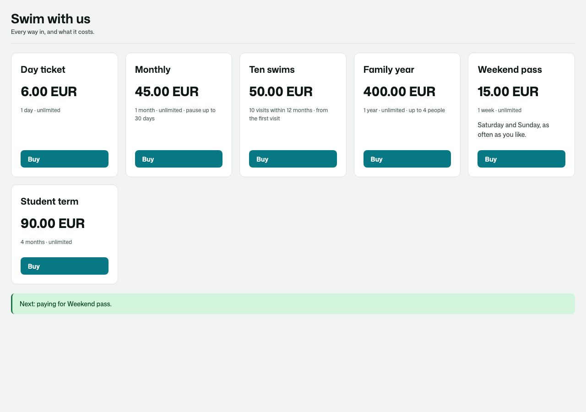
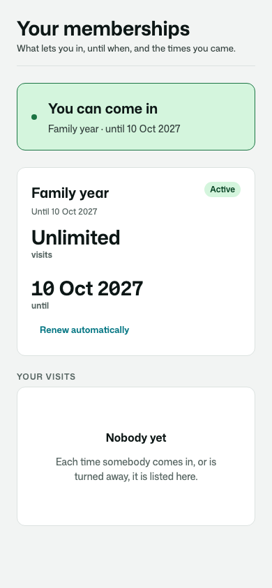
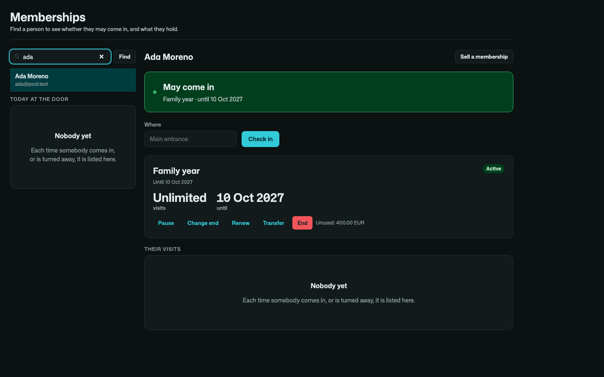

# Osysharp.Memberships

**What lets a person in.** Day tickets, weekly and monthly memberships, yearly passes, cards of ten visits, family
memberships — for a pool, a studio, a museum, a co-working space, a club.

- **Plans** with a price and a length (days, weeks, months, years), a number of visits or none, starting when sold or
  on the **first visit**, how long they may be **paused**, how many **people** they let in, and whether they **renew**.
- **Check-in** that uses a visit and never goes below zero, and — when somebody may not come in — **says why**, in a
  sentence to read out: *Monthly is paused until 3 March.* · *Ten swims has no visits left.* · *Day ticket ran out on
  10 October.* Every attempt is kept: the door log, with undo for a mistaken scan. Members can check themselves in.
- **Pausing** that moves the end date by the days paused, within what the plan allows, ending by itself on its day.
- **The notice before the end** — or, for one set to renew, the call to charge and renew it.
- **Renewal**, made once however often it is asked, starting when the last one ends.
- **Transfer** to somebody else — the same end, the visits left — and **family members** on one membership.
- **What is left in money**: the share of visits not used, or of days not yet run, for a refund or a change of plan.
- **Every change is a record** — paused, resumed, end date changed, ended, transferred — with who and why.

A visit card's visits are a pack of [Osysharp.PrepaidCredits](https://github.com/osysharp): they never go below zero,
each use is a line in its holder's statement, and they count in the value still owed.

| Whether you can come in | The desk |
|---|---|
|  |  |

| Selling at the desk | The plans |
|---|---|
|  |  |

| A price list of the app's own | On a phone · in the dark |
|---|---|
|  |   |

## Use it

```osy
// app.osy
use Osysharp.Identity@0;
use Osysharp.PrepaidCredits@0;
use Osysharp.Memberships@0;
```

```osy
using Osysharp.Identity;
using Osysharp.Memberships;

policy SellsMemberships => IsDesk;     // plans, selling, pausing, ending, renewing, transferring
policy AdmitsMembers => IsGate;        // checking people in
policy ManagesCredits => IsDesk;       // the desk reads a card's visits through PrepaidCredits
policy SpendsCredits => IsGate;

app.Memberships = new MembershipsSetup { NoticeDays = 7, MembersMayPause = true, MembersCheckIn = true };

// At the counter, or when an order is paid (the order line as the reference):
var m = SellMembership(person, MembershipPlan.Single(p => p.Name == "Monthly"), reference: "order-1041-1");

// At the door:
var a = CheckIn(person, "Main entrance");
var says = a.State == AdmissionState.Admitted ? "Welcome" : a.Reason;

// Renewing by itself: charge the kept card, then renew.
[On] void RenewWhenDue(MembershipRenewalDue e) { RenewMembership(e.Membership); }
```

From code: `EntryFor(person)` (may they enter — nothing used), `PauseMembership(m, until)`, `ResumeMembership(m)`,
`ExtendMembership(m, until, "why")`, `EndMembership(m, "why")`, `TransferMembership(m, other)`, `AddToMembership(m,
person)`, `UndoAdmission(a)`, `UnusedValueOf(m)`, `MembershipsOf(person)`, `AdmissionsToday()`. Events:
`MembershipSold`, `MemberAdmitted`, `AdmissionRefused`, `MembershipPaused`, `MembershipResumed`, `MembershipEndingSoon`,
`MembershipRenewalDue`, `MembershipRenewed`, `MembershipEnded`, `MembershipTransferred`.

## Pages

`/memberships` (the signed-in person), `/staff/memberships` (the desk) and `/staff/memberships/plans` (the plans) are
served in the app's working shell, in its theme. Take one over by declaring a component of the same name, or place
`MyMemberships`, `MembershipsDesk`, `MembershipPlans` or `MembershipPlanList` (a price list) on a page of your own.

## Personal data

Where somebody checked in, why they were refused and why a change was made are classified personal content. In an app
with Osysharp.Privacy, Osysharp.Privacy.Memberships arrives by itself: a person's memberships, their place on others'
and their check-ins are in their copy of their data and are erased when they ask.

## What informed it

- **Glofox** — pausing that pushes the next payment date out by the days paused; members pausing themselves where the
  business allows it; credit packs beside memberships.
- **Mindbody and studio class cards** — cards that expire a set time after purchase; passes that start on first use.
- **Nexudus** — day passes valid for a calendar day; when a person holds several passes, the one used is chosen by rule.
- **Museums and leisure centres** — family and joint memberships naming the people they admit; turnstile self check-in.

## Source

[github.com/osysharp/memberships](https://github.com/osysharp/memberships). Its tests (`tests/`) are a public pool's:
every behaviour above, each seam shown, and the pages under `osy test --pixels`.

## Examples

Taken from this package's own tests, which compile and run on every release.

```osy
using Osysharp.Identity;
using Osysharp.UserAccounts;
using Osysharp.PrepaidCredits;
using Osysharp.Memberships;
using Osysharp.Workflow;

[Test(Pool)]
[runas(Cass)]
void a_monthly_membership_runs_a_month_from_today() {
  var m = SellMembership(Ada, Plan("Monthly"), "till-1");
  Assert.True(m.Unlimited);
  Assert.True(m.ValidUntil > DateTime.UtcNow.AddDays(27));
  Assert.True(m.ValidUntil < DateTime.UtcNow.AddDays(32));
  Assert.Equal(45m, m.Price);
  Assert.True(EntryFor(Ada).CanEnter);
}
```

From [`tests/admission.test.osy`](tests/admission.test.osy).

```osy
using Osysharp.Identity;
using Osysharp.UserAccounts;
using Osysharp.PrepaidCredits;
using Osysharp.Memberships;
using Osysharp.Workflow;

[Test(Pool)]
[runas(Ada)]
void a_swimmer_pauses_their_monthly_and_its_end_moves_by_the_days_it_was_paused() {
  var m = Sold(Ada, "Monthly");
  var end = m.ValidUntil.Value;
  PauseMembership(m, DateTime.UtcNow.AddDays(14), "Broken arm");
  var paused = CheckInAsTheGate(Ada);
  Assert.Equal(AdmissionState.Refused, paused.State);
  Assert.True(paused.Reason.StartsWith("Monthly is paused until "));
  TestClock.Advance(TimeSpan.FromDays(6));
  ResumeMembership(m, "Back early");
  var resumed = Membership.Single(x => x.Id == m.Id);
  Assert.Equal(end.AddDays(6), resumed.ValidUntil.Value);
  Assert.Equal(6, resumed.PausedDays);
  Assert.Equal(AdmissionState.Admitted, CheckInAsTheGate(Ada).State);
  var trail = ChangesTo(m);
  Assert.Equal(MembershipChangeKind.Resume, trail[0].Kind);
  Assert.Equal("Broken arm", trail[1].Reason);
  Assert.Equal(Ada.Id, trail[1].By.Id);
}
```

From [`tests/changes.test.osy`](tests/changes.test.osy).

```osy
using Osysharp.Identity;
using Osysharp.UserAccounts;
using Osysharp.PrepaidCredits;
using Osysharp.Memberships;
using Osysharp.Workflow;

[Test(Pool)]
[runas(Cass)]
void even_the_cashier_cannot_write_a_membership_s_dates_or_visits_directly() {
  var m = SellMembership(Ada, Plan("Ten swims"));
  Assert.Denied(() => { m.ValidUntil = DateTime.UtcNow.AddYears(5); UnitOfWork.Commit(); });
  Assert.Denied(() => { m.ValidFrom = DateTime.UtcNow; UnitOfWork.Commit(); });
  Assert.Denied(() => { m.PausedDays = 0; m.PausedAt = DateTime.UtcNow; UnitOfWork.Commit(); });
  Assert.Denied(() => { m.EndedAt = DateTime.UtcNow; UnitOfWork.Commit(); });
  Assert.Denied(() => { new Membership { Holder = Bo, Plan = Plan("Monthly") }; UnitOfWork.Commit(); });
  Assert.Denied(() => { m.Delete(); UnitOfWork.Commit(); });
}
```

From [`tests/security.test.osy`](tests/security.test.osy).

## Learn more

- [The Osysharp.Memberships reference](https://osysharp.com/reference/ui/memberships-kit/)
- [Osysharp.Memberships in the package catalogue](https://osysharp.com/packages/#osysharp-memberships)
- [The Osy# reference](https://osysharp.com/reference/) — the language, the runtime and every kit
- [`llms-full.txt`](https://osysharp.com/llms-full.txt) — the whole reference and specification as one Markdown file, for a coding agent

## Licence

MIT — see [`LICENSE`](LICENSE).
